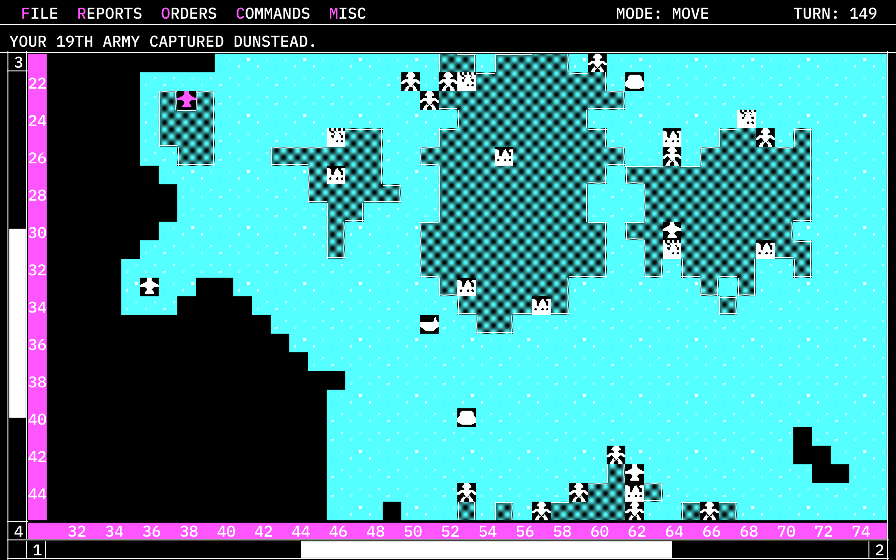
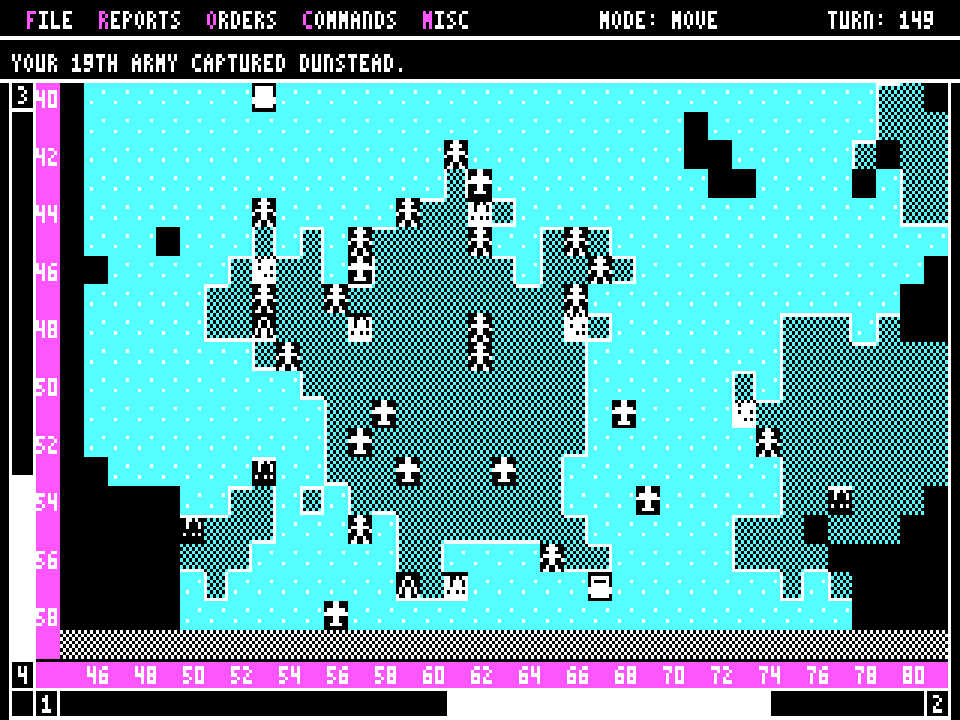

# Empire

A tribute to *Empire*, the 1987 strategy game by Walter Bright and Mark
Baldwin, as the Interstel release looked on an IBM PC in CGA graphics mode.
It is written from scratch in Rust and compiled to WebAssembly, so it runs in
a browser. This project is not affiliated with Walter Bright, Mark Baldwin,
Interstel or Digital Mars.

**Play it: <https://dzoba.github.io/empire/>**

It plays like the 1987 game: the same eight units, production, fog of war,
combat, standing orders, menus, dialogs, reports and map editor. It drops the
"find word N on line L of page P" manual check, and it removes the old
hardware limits: the world can be any size, and the screen can show more of
it. The computer opponents are a new design.

By default it draws at your screen's real resolution: the original's layout
and four CGA colours, with sharp text and smoothed icons. **Misc > Display >
Look** switches to the authentic 1987 picture, pixel for pixel.



<details><summary>The same screen in the CGA look</summary>



</details>

## Run it locally

You need Rust with the WebAssembly target. Nothing else: no npm, no
wasm-bindgen.

```bash
rustup target add wasm32-unknown-unknown
```

```bash
./scripts/build-web.sh
```

```bash
./scripts/serve.sh
```

Then open <http://localhost:8080>. Start a game with **File > New Game**
(Ctrl+N is reserved by most browsers, so use the menu).

Saved games are compressed (a 100×60 game at turn 200 is about 17 KB) and
kept in the browser's IndexedDB. Settings, your maps and the commanders log
are kept in local storage. **File > Save As** can also download a save file
(`.emp`), and **File > Load** can read one back.

## Use the art from your original disk (optional)

The repository ships its own CGA-style icons and font. If you have the
original game, the importer converts its icon sets, font, title picture and
the eighteen built-in maps into the formats this game reads:

```bash
python3 tools/interstel_import/import.py path/to/EMPDAT
```

That writes to `assets/original/`, which git ignores. Rebuild with
`scripts/build-web.sh` and the page picks the files up automatically. Switch
between the original icon sets and the built-in ones under
**Misc > Display**. The original maps appear under **New Game > World Map? >
Select**. The file formats are documented in
[docs/interstel-formats.md](docs/interstel-formats.md).

## Controls

The keys follow the original manual.

| Action | Keys |
| --- | --- |
| Move a unit or the cursor | Numeric keypad, arrows, Home/PgUp/End/PgDn for diagonals, or the 1–9 digit row laid out like a keypad |
| Move five squares (survey) | Shift + direction |
| Skip move / Wait | Space or keypad 0 / W or keypad . |
| Sentry, Go Home, Go Random, Go Direction | S, H, R, D |
| Move To, Patrol To, Escort Ship | T (or keypad +), P, E; then move the line and press the same key or Enter |
| Load Ship, Unload Ship, Clear Orders | L, U, O |
| Survey mode, Move mode, Group survey | V, M, G |
| Activate (in survey), Flight paths | A, F |
| Center screen, Info | C (or keypad 5), I |
| Next unit, End turn (skip units without orders) | Tab, Shift + Space |
| Zoom the map in and out | ] and [ (or = and -) |
| Status, Combat report, World map, Ship report | F5, F6, F7, F8 |
| Set production, Production map | F9, F10 |
| Scroll the map | F1–F4 (Shift for half a screen), mouse wheel |
| Drop a menu | Click it, or Ctrl + its first letter |

With the mouse: click a square next to the blinking unit to move there,
click farther away to give a Move To order, right-click to switch between
move and survey modes, and double-click for information.

## Change the game

Everything you are likely to want to change is data or a single function.

| What | Where |
| --- | --- |
| Unit speed, hits, damage, attack and defense factors, build times, fuel, cargo, who can see submarines | `Rules::default()` in [crates/core/src/types.rs](crates/core/src/types.rs) |
| Map size and land amount for new worlds | In game: **New Game > World Map?** (size and land buttons). Presets: `MAP_SIZES` in [crates/app/src/app.rs](crates/app/src/app.rs). Generator: [crates/core/src/mapgen.rs](crates/core/src/mapgen.rs) |
| Text size (high-res look) | In game: **Misc > Display > Text size**. Sizes: `TEXT_SIZES` in [crates/app/src/app.rs](crates/app/src/app.rs) |
| Map zoom (high-res look) | In game: **[** and **]**, or **Misc > Display > Map zoom**. Steps: `MAP_SQUARES` in [crates/app/src/app.rs](crates/app/src/app.rs) |
| High-res or CGA look | **Misc > Display > Look**. Drawing: [crates/app/src/gfx.rs](crates/app/src/gfx.rs) |
| Screen size and pixel shape (CGA look) | **Misc > Display > Screen size / Pixel shape**. Layout: [crates/app/src/layout.rs](crates/app/src/layout.rs) |
| Icons | The `BUILTIN` text in [crates/app/src/tiles.rs](crates/app/src/tiles.rs), one 8×8 grid of digits per icon |
| Colours | [crates/app/src/theme.rs](crates/app/src/theme.rs) |
| Fonts | `smooth_font()` and `small_font()` in [crates/app/src/text.rs](crates/app/src/text.rs) |
| Computer strategy | [crates/core/src/ai/](crates/core/src/ai/): `plan.rs` (what it knows each turn, and the Expert/Standard `Style` switches), `production.rs` (what cities build), `units.rs` (what units do) |
| Players, efficiencies, handicaps | `GameConfig` and `PlayerConfig` in [crates/core/src/config.rs](crates/core/src/config.rs) |

Maps are plain text (`.emap`): one line per row, `.` sea, `+` land, `*` city,
any width and height. Make them in the map editor (**File > Map Editor** on
the desktop) or in a text editor, and load them with **Select > Upload**.

## How it is built

```
crates/core   rules engine: map, units, cities, combat, fog of war, orders,
              computer opponents, world generator, A* pathfinding, saves.
              No I/O.
crates/app    the user interface: menus, dialogs, the play screen and the map
              editor, drawn on the original's 320x200 layout grid into an
              indexed-colour framebuffer at any resolution. No I/O.
crates/web    WebAssembly entry points with a plain C ABI.
crates/cli    headless tools: computer-vs-computer games, screenshots.
web/          index.html and a ~350-line JavaScript host (canvas, input,
              storage, sound, file upload/download).
tools/        the importer for original game files.
```

The UI drives the engine through one loop. `Game::advance` runs computer
players and standing orders until a person has to decide something, then
returns a `Pending` value: a unit needs orders, a city needs production, the
next human must come to the screen, and so on. The UI answers with a command
(`cmd_move`, `cmd_set_orders`, `cmd_set_production`, ...) and calls `advance`
again. Every game is reproducible from its seed, and a save holds the random
generator's state, so a loaded game continues exactly as it would have.

### Drawing at any resolution

Every screen is laid out on the original's grid: 4×8 text cells, 8×8 map
squares, 80 columns at 320 pixels. The framebuffer maps each grid pixel to a
block of device pixels. In the high-res look:

* text is rasterised from IBM Plex Mono, sized so each character fills
  exactly one 4×8 cell, so every layout written for the original still fits;
* rules and frames are drawn as thin hairlines;
* unit and city icons are enlarged with Scale2x, which rounds diagonal
  edges without adding colours;
* terrain dithers are drawn as a fine checker at device resolution, the way
  a CRT blended them;
* the screen is redrawn only when something visible changes. A full
  2880×1800 redraw takes about 12 ms in the browser.

### The computer opponent

Each turn the planner reads the computer player's own map (never the true
one) and splits the known land into continents. For each continent it works
out how many armies are still useful there (two per neutral city, three per
enemy city, one per enemy army, and scouts for unexplored ground), and where
spare armies should wait for a ship. It also builds a field of fighter
distances to the nearest friendly city, so no fighter flies past the point of
return unless it is sent on purpose.

Units then choose one at a time. Each searches outward from where it stands,
scores every target it reaches by value and distance, and steps towards the
best one; targets accept only a few takers, so units spread out. Transports
gather armies at a pickup point, deliver them to the best landing, and
unload. While much of the world is unexplored, a few fighters fly one-way
scouting missions.

Expert weighs exact combat odds before every attack, escorts loaded
transports, sends damaged ships home for repair, remembers enemy sightings,
builds a mixed navy, and lets fighters make one-way strikes on loaded
transports. Standard plays the plainer game, with the 10% efficiency
handicap described below.

### Tests and tools

```bash
cargo test --workspace
```

The tests cover movement, cargo, docking and repair, fuel, combat odds, city
capture, bombardment, submarine stealth, production, victory, routing, sentry
behaviour, hot-seat hand-off, saves, map validation, and full
computer-versus-computer games on several map sizes.

```bash
cargo run --release -p empire-cli -- sim --players 3 --turns 500
```

```bash
cargo run --release -p empire-cli -- shots --out target/shots --assets assets/original
```

```bash
cargo run --release -p empire-cli -- arena --games 40 --a expert --b standard
```

`sim` plays computer players against each other and prints progress. `shots`
drives the interface through a scripted session and writes a screenshot of
each step. `arena` plays one computer style against another, every map from
both starting positions, and reports the score.

## How it follows the original

The look and the interface come from the original running in CGA mode:
screen layout to the pixel at 320×200, the 3×5 capital font, the menus and
their shortcuts, dialog styles, message wording, the 0.55-second blink. The
rules come from the Interstel manual and its README (for example cruisers
take 36 turns to build, not the 35 in the manual's table). The computer
opponents are new, not a copy of the original's.

Deliberate differences:

* No manual-lookup security check.
* Any map size and a choice of screen sizes (the original was fixed at
  100×60 and 320×200).
* Pathfinding uses A*, so units with Move To orders find their way around
  obstacles.
* Time-savers: **Next Unit** (Tab) and **End Turn** (Shift + Space), which
  leaves every unit without orders where it is. It asks first if more than
  ten units would be skipped.
* In the high-res look the map zooms independently of the text size.
* The computer opponents are a new design that plans from its own
  fog-of-war view of the map.
* The "Standard" computer opponent plays a plainer strategy and has a hidden
  10% efficiency handicap. The handicap reproduces the original's 47%/53%
  ratings screen.
* Not implemented: play-by-mail and the "grow" animation of dialog boxes.

## Licensing

This is a fan project, not affiliated with Walter Bright, Mark Baldwin,
Interstel or Digital Mars. *Empire* is their game; the name is used here only
to say what this is a tribute to.

The code in this repository is original. It was written from the rules in the
Interstel manual and from watching the 1987 game run, and contains no code
from the original game or from Walter Bright's later Empire source. No
Interstel files are included: the importer converts files from your own copy
into a git-ignored folder, and the published game uses only the built-in art.

The built-in icons are original artwork. The built-in pixel font is derived
from font8x8 by Daniel Hepper (public domain). The smooth font is IBM Plex
Mono (SIL Open Font License, see
[crates/app/assets/fonts/OFL.txt](crates/app/assets/fonts/OFL.txt)).

No open-source license has been chosen for the code yet, so it is all rights
reserved for now.
